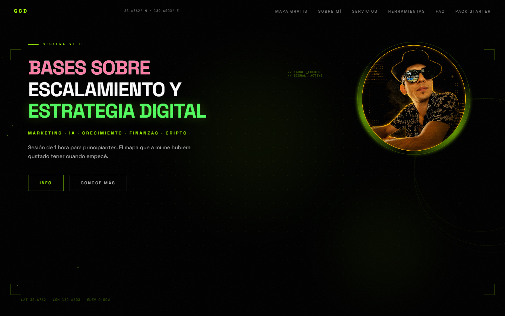
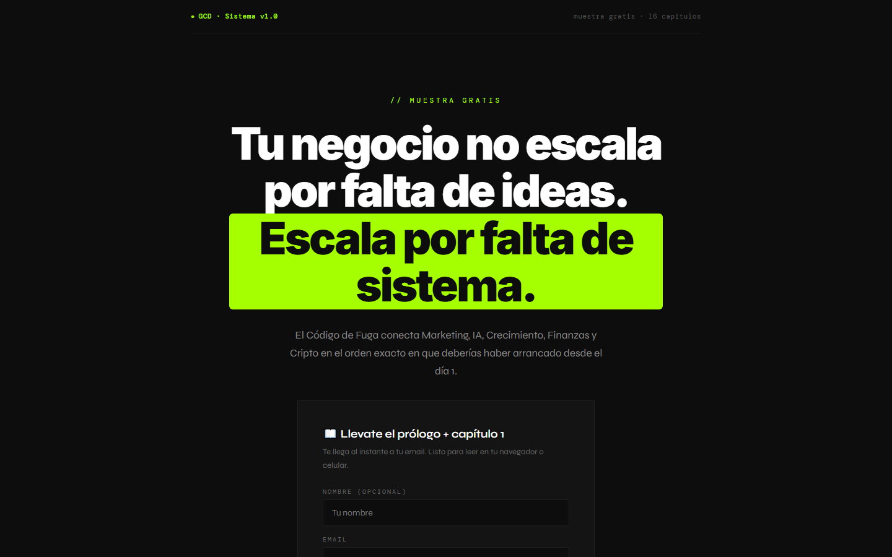
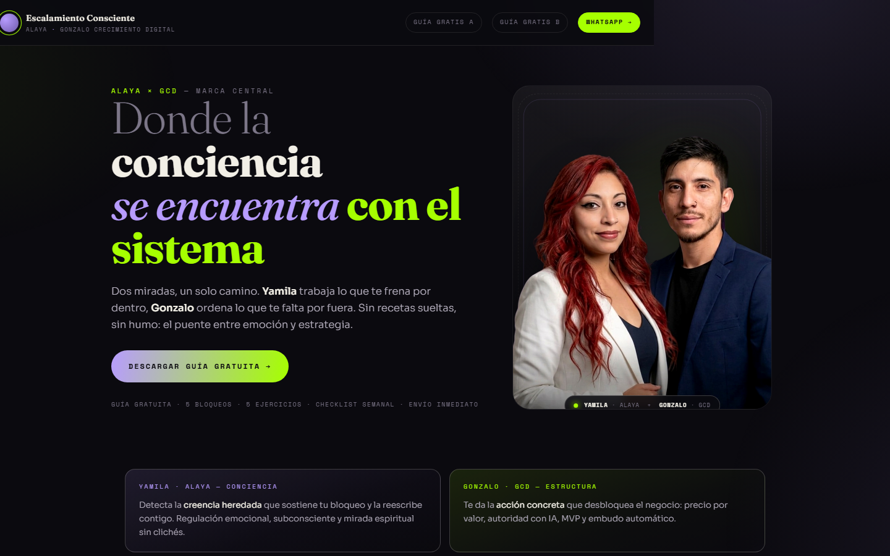

# Gonzalo Crecimiento Digital

Sitio estático y sistema de captación para productos digitales: landings de venta, herramientas interactivas, páginas de gracias, lead magnets y automatizaciones.

**Sitio en vivo:** [landing-gcd.vercel.app](https://landing-gcd.vercel.app)



<p align="center">
  
  
</p>

## Qué incluye

- **Landings de venta** para Pack Starter ($5), Las 5 Áreas ($19) y tres herramientas por avatar.
- **Herramientas interactivas** con lógica en JavaScript: diagnóstico de 5 áreas, calculadora de pérdida y plan de 15 minutos.
- **Embudo completo**: formulario de captación, páginas de gracias, eventos de Meta Pixel y GA4.
- **Programa Alaya**: landings, webinar y página central de Escalamiento Consciente.
- **Sistema de diseño propio**: tema dark, verde neón `#A6FF00`, tipografía Inter + DM Mono, componentes HUD.
- **Tooling local** para preview, validación de enlaces y captura de screenshots con Playwright.

## Stack

| Capa | Tecnología |
| --- | --- |
| Sitio | HTML, CSS y JavaScript sin build |
| Hosting | Vercel (`site/` como output) |
| Captación | Google Apps Script + Google Sheets |
| Pagos | Hotmart |
| Tracking | Meta Pixel + Google Analytics 4 |
| Automatización | Playwright (capturas y render de piezas) |

## Estructura

```text
.
├── site/                  # Única fuente del sitio publicado
│   ├── index.html
│   ├── landings/          # Landings de venta y páginas de gracias
│   ├── alaya/             # Programa Escalamiento Consciente
│   ├── assets/            # PDFs y recursos descargables
│   └── activos/           # Imágenes públicas
├── tools/                 # Preview local, check de enlaces y screenshots
├── docs/                  # Arquitectura, deploy y capturas
├── vercel.json            # Rewrites, headers y CSP
└── package.json
```

La operación del negocio —estrategia, clientes, métricas, credenciales y medios— se mantiene en un repositorio privado. Este repositorio es la versión curada para portafolio.

## Desarrollo local

Requiere Node.js 20 o superior.

```bash
npm install
npm run dev
```

El sitio queda disponible en `http://127.0.0.1:3000`. El servidor de desarrollo respeta los rewrites de `vercel.json`.

### Validar enlaces

```bash
npm run check:links
```

### Regenerar screenshots

```bash
npm run screenshots
```

## Deploy

El deploy se hace en Vercel con `site/` como directorio de salida:

1. Importar el repositorio en Vercel.
2. Framework preset: **Other**.
3. Output directory: `site`.
4. Deploy.

También se puede publicar desde la CLI:

```bash
vercel --prod
```

## Notas de seguridad

- No se versionan `.env`, credenciales de Google, tokens de Meta ni datos de leads.
- La carpeta `_private/` está ignorada por Git y por Vercel.
- Las credenciales se cargan por variables de entorno en los servicios correspondientes.

## Autor

**Gonzalo Cortez** — Gonzalo Crecimiento Digital  
[Instagram](https://www.instagram.com/gonzalo.crecimientodigital/) · [YouTube](https://www.youtube.com/@gonzalo.crecimientodigital)
